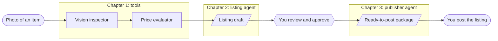

# Kleinanzeigen Agent: a hands-on ADK tutorial for TypeScript

[](https://github.com/lukas-zech-software/kleinanzeigen-agent/actions/workflows/verify-chain.yml)
[](LICENSE)
[](.nvmrc)

Build an AI agent that turns a photo of an item into a classified listing that
is ready to post, one chapter at a time. _Kleinanzeigen_ is German for
classified ads.

The [Agent Development Kit](https://adk.dev/) (ADK) is Google's open-source
framework for building AI agents. This tutorial teaches it by doing. Each
chapter gives you a working TypeScript project with marked gaps, and you fill
them in. Your coding agent can review your work and give hints without giving
away the solution.

I am building it to teach myself ADK and the Google services around it, and I
publish it so that other developers can learn the same way.

> **Status:** chapter 1 of 4 is available. Chapters 2 to 4 are planned. See the
> [roadmap](docs/roadmap.md).

- **Here to learn?** Go to the [Quick start](#quick-start).
- **Here to see how it is built?** Take the [guided tour](#guided-tour).

## What you build



Chapter 4 moves the same pipeline to Google Cloud, where a new photo starts it.

| Chapter | You learn                                                               | Status    |
| ------- | ----------------------------------------------------------------------- | --------- |
| 1       | ADK tools with typed Zod schemas, structured output, search grounding   | Available |
| 2       | An agent that uses the tools and writes a draft for a person to review  | Planned   |
| 3       | A second agent that validates an approved draft and hands it to a human | Planned   |
| 4       | Cloud Run services started by storage events through Eventarc           | Planned   |

The agent never posts a listing. It prepares and checks one, and a person
decides. The [roadmap](docs/roadmap.md) describes each chapter.

## Quick start

You need:

- Node.js 26 or newer and Git,
- a Google AI Studio API key, which you create at
  [aistudio.google.com/apikey](https://aistudio.google.com/apikey),
- some experience with TypeScript. You do not need to know ADK.

Clone the repository and start chapter 1 from its starter tag:

```sh
git clone https://github.com/lukas-zech-software/kleinanzeigen-agent.git
cd kleinanzeigen-agent
git switch -c my-chapter-01 chapter-01-starter-v3
npm ci
cp .env.example .env    # then add your GEMINI_API_KEY
```

Clone rather than fork. If you do fork, untick "Copy the `main` branch only",
because the chapters live on their own branches.

Check your work at any time:

```sh
npm run typecheck
npm run test:tools -- examples/photos/game-boy.jpg
```

`test:tools` calls the Gemini API and uses your quota. On the untouched starter
it stops with `inspectImage is not implemented yet (TODO ch01-3).` That is
your starting point.

When chapter 1 is finished, the same command prints something like this:

```
Tools under test: vision_inspector, price_evaluator
VisionInspectorTool result: {
  title: 'Original Nintendo Game Boy DMG-01 Handheld Console Classic Grey',
  detectedCategory: 'Handheld Game Consoles',
  condition: 'used',
  keyAttributes: [
    'Nintendo',
    'Game Boy',
    'DMG-01',
    'Grey',
    'Vintage Handheld System',
    '8-bit'
  ]
}
PriceEvaluatorTool result: { priceMin: 65, priceMax: 130, recommendedPrice: 90, currency: 'EUR' }
```

[examples/photos](examples/photos/README.md) has five freely licensed photos
of typical second-hand items. Your own photo works too.

## Working through a chapter

Chapters are branches, not folders. The repository root is always the project.

```
main ── chapter-01-starter ── chapter-01-solution ── chapter-02-starter ── …
```

- `chapter-NN-starter` has the types and boilerplate for a chapter. The work
  you do is marked as `// TODO(chNN-k)`.
- `chapter-NN-solution` is a reference implementation. Read it as an example
  and not as the only right answer.
- Tags such as `chapter-01-starter-v3` are fixed snapshots. Branches may be
  rebased when the tutorial is corrected. Tags never move.

On a chapter branch, [CURRENT_CHAPTER.md](CURRENT_CHAPTER.md) describes that
chapter: what you need, what you build, and how to check it. The file changes
with the branch.

1. Read `CURRENT_CHAPTER.md`.
2. Work through the `TODO(ch01-…)` blocks. Delete each TODO comment when its
   task is done: the chapter check counts a remaining marker as open work.
3. Run `npm run format` before you commit. Prettier keeps the code looking the
   same everywhere.
4. Ask your coding agent "is my chapter done?". In Claude Code this runs the
   `check-chapter` skill, which tells you which goals are still open and where
   to look. Other coding agents find the same instructions in
   [AGENTS.md](AGENTS.md).

To see the reference solution:

```sh
git diff chapter-01-starter-v3 chapter-01-solution-v3
```

Start the next chapter from its own starter tag. Your work stays on your
branch.

## Guided tour

If you want to judge how this repository is made, these are the parts worth
reading:

- **[The branch chain and its check](scripts/verify-chain.sh).** Each starter
  is built on the previous chapter's solution. The script proves that the
  chain still holds: ancestry, a clean typecheck on every chapter branch, no
  open TODO in a solution, and consistent formatting.
- **[The CI workflow](.github/workflows/verify-chain.yml).** It runs that
  script on every push and once a week, so a broken chain shows up as a red
  badge.
- **[The `check-chapter` skill](.claude/skills/check-chapter/SKILL.md).** A
  coding agent reviews the learner's work against
  [written criteria](.claude/skills/check-chapter/chapters/chapter-01.md),
  names the gap, and gives a hint. It is forbidden to read the solution.
- **[AGENTS.md](AGENTS.md).** The rules that make any coding agent behave as a
  tutor here and not as a code generator.
- **[How this was built](docs/how-this-was-built.md).** The workflow behind the
  repository: design spec, implementation plan, verified chain. The design
  specs are in [docs/superpowers/specs](docs/superpowers/specs).

## Questions and feedback

Ask questions in
[Discussions](https://github.com/lukas-zech-software/kleinanzeigen-agent/discussions).
If something in the tutorial is wrong or no longer works, please open an
[issue](https://github.com/lukas-zech-software/kleinanzeigen-agent/issues).
[CONTRIBUTING.md](CONTRIBUTING.md) explains how fixes travel through the
chapter branches.

## About the author

I'm Lukas Zech, a Senior Staff/Principal Software Engineer from Augsburg. I've
been building software professionally since 2010, across freelance projects,
startups (including my own) and engineering teams, mostly in TypeScript and
across the whole stack.

- Sharing knowledge, mentoring and a good developer experience are part of how
  I work. Software development is a team sport.
- I'm exploring how coding agents can make everyday engineering better. My
  rule: AI-generated code meets the same standards as everything else we ship.
- This tutorial is how I'm teaching myself ADK. I publish it so others can
  learn along with me.

Want to know more about me?
[Visit my GitHub profile](https://github.com/lukas-zech-software).

## License and disclaimer

My code and the tutorial text are released under the [MIT License](LICENSE).
The example photos are in the public domain or under CC0, as listed in
[examples/photos](examples/photos/README.md). The `gemini-api-dev` skill in
[.agents/skills](.agents/skills/gemini-api-dev) comes from
[google-gemini/gemini-skills](https://github.com/google-gemini/gemini-skills)
and stays under the [Apache License 2.0](LICENSES/Apache-2.0.txt).

This project is not affiliated with, endorsed by, or connected to
Kleinanzeigen or its operator. The name only describes the kind of listing the
agent prepares. The tutorial does not automate posting: a person publishes
every listing.
